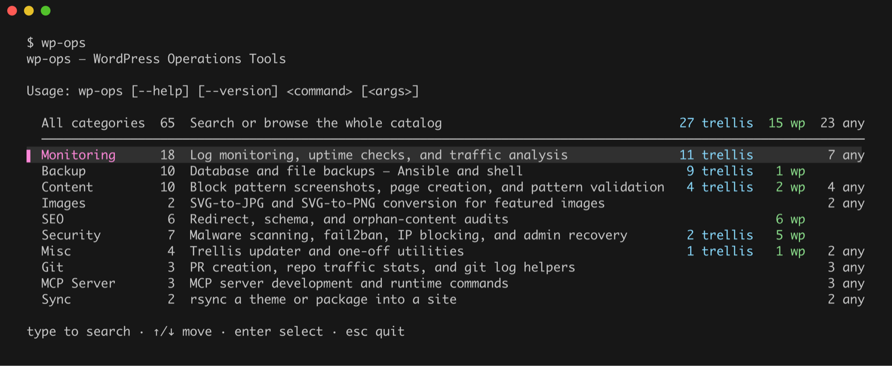

<div align="center">
  <picture>
    <source media="(prefers-color-scheme: dark)" srcset="assets/logo-dark.svg">
    
  </picture>
  <h1>WP OPS</h1>
</div>
<div align="center">

[](https://github.com/imagewize/wp-ops/releases)
[](https://github.com/imagewize/wp-ops/releases)
[](LICENSE.md)

</div>

<div align="center">
wp-ops is a CLI and an MCP server for WordPress operations — deployments, database and files backup, security scanning, monitoring, and content workflows — backed by manifest-driven scripts, Ansible playbooks, and guides, optimized for <a href="https://roots.io/trellis/">Trellis</a>/<a href="https://roots.io/bedrock/">Bedrock</a> workflows. Run it yourself from the terminal, or let Claude and other MCP clients call the same operations as tools.
</div>

## Contents

- [wp-ops CLI](#wp-ops-cli)
- [MCP Server](#mcp-server)
- [Trellis](#trellis)
- [Bedrock](#bedrock)
- [WP-CLI](#wp-cli)
- [Nginx](#nginx)
- [Scripts](#scripts)
- [WordPress Utilities](#wordpress-utilities)
- [Troubleshooting](#troubleshooting)

## wp-ops CLI

The command-line entry point for everything in this repo (the [MCP server](#mcp-server) exposes the same operations to AI clients) — a single binary that auto-discovers commands across every category, groups them by domain, and renders real `--help`, guided prompts, and shell completions from each command's manifest.

<p align="center">
  
</p>

```bash
# Recommended: Homebrew
brew install imagewize/tap/wp-ops
wp-ops init                  # install shell completions (one-time)

# Without Homebrew, build from source (needs Go 1.26+):
git clone https://github.com/imagewize/wp-ops.git && cd wp-ops
go build -o wp-ops ./go
sudo mv wp-ops /usr/local/bin/   # or ~/.local/bin, or anywhere on your PATH
wp-ops init

wp-ops                       # interactive picker
wp-ops --help                # list all categories
wp-ops backup --help         # list commands in one category
wp-ops <category> <command> [args...]

wp-ops search webp           # find a command by name or description
wp-ops list --platform wordpress   # only what runs on any WordPress site
wp-ops docs oom              # search the guides, not just the commands
wp-ops doctor                # check dependencies and environment
wp-ops <command> --where     # print the path to a command's script
```

Commands are grouped by **domain** and tagged with a **platform** (`trellis`, `wordpress` or `any`), so `wp-ops list --platform wordpress` shows only what runs against the site in front of you. The scripts, playbooks and guides are embedded in the binary — once it's on your PATH you can delete the clone.

Run `wp-ops doctor` first to see which external tools (WP-CLI, Ansible, ImageMagick, `gh`, `cwebp`, Node, …) are installed, and `wp-ops init` once for `<TAB>` completion in zsh, bash or fish. Homebrew installs also provide `trellis-ops`, so everything is reachable as `trellis ops <...>` from [trellis-cli](https://github.com/roots/trellis-cli).

More detail:

- [Using the CLI](docs/cli/usage.md) — categories and platforms, the interactive picker, completion, `wp-ops docs` guide search, and which commands run on the server
- [trellis-cli plugin](docs/cli/trellis-cli-plugin.md) — `trellis ops`, plus the `TRELLIS_DIR` and `WP_SITE_DIR` project directories

## MCP Server

The second way to use wp-ops, alongside the CLI. Exposes wp-ops operations as [MCP](https://modelcontextprotocol.io) tools, so Claude (and other MCP-compatible clients) can call them directly instead of running the underlying scripts by hand. Scaffold stage — eighteen tools so far, spanning security/SEO audits, backups, dev-site sync, content publishing/verification, SSH/SCP passthrough, and a catalog bridge (`command_search`/`command_run`) that exposes the full CLI catalog without a dedicated tool per command. See [mcp-server/README.md](mcp-server/README.md) for the full tool list, setup, transports (stdio/Streamable HTTP), and Docker usage.

## Trellis

If you have trellis-cli, every command below is also reachable as
`trellis ops <...>` — same binary, same behaviour, no project required.
See [the trellis-cli plugin guide](docs/cli/trellis-cli-plugin.md).

```bash
trellis ops                                    # Trellis-relevant categories only
trellis ops backup database-pull example.com production
trellis ops monitoring quick-status example.com production
```

`trellis ops` scopes its *listing* to commands tagged `@platform trellis`;
running a command is never scoped, so anything in the catalog still works if
you name it. Plain `wp-ops` shows the full catalog.

### Command reference

`wp-ops list --platform trellis` (equivalently, `trellis ops`) is the always-current, grouped-and-counted listing; `wp-ops search <term>` finds one command. `(runs on server)` marks the log readers that execute on the host — see [Running the monitors from wp-ops](trellis/monitoring/README.md#running-the-monitors-from-wp-ops).

### Guides

| Tool | Description | Docs |
|------|-------------|------|
| **Updater** | Safely update Trellis while preserving custom configurations | [→](trellis/updater/README.md) |
| **Backup Tools** | Ansible playbooks for database and files backup/push/pull | [→](trellis/backup/README.md) |
| **Provisioning** | Common provisioning commands and workflows | [→](trellis/provision/README.md) |
| **New Machine Setup** | Set up macOS for Trellis development | [→](trellis/provision/NEW-MACHINE.md) |
| **Project Setup** | Clone and configure an existing Trellis/Bedrock project | [→](trellis/provision/PROJECT-SETUP.md) |
| **Monitoring** | Nginx log monitoring for traffic analysis and security threat detection | [→](trellis/monitoring/README.md) |
| **Security** | fail2ban IP blocking, manual deny rules, and AbuseIPDB reputation lookup | [→](trellis/security/README.md) |

## Bedrock

| Tool | Description | Docs |
|------|-------------|------|
| **Local Package Development** | Test an in-development plugin/theme branch in a Bedrock site via a Composer `path` repository, before tagging a release | [→](docs/bedrock/local-package-development/README.md) |
| **WP-CLI Config** | Standard `wp-cli.yml` for Bedrock path setup plus a `wp imagewize pattern-validate` command for canonicalizing block pattern files | [→](docs/bedrock/wp-cli-config/README.md) |

## WP-CLI

| Tool | Description | Docs |
|------|-------------|------|
| **Content Creation** | Automated page creation and content management workflows | [→](wp-cli/content-creation/README.md) |
| **Migration Tools** | Migrate WordPress sites to Trellis/Bedrock (single and multi-site) | [→](wp-cli/migration/README.md) |
| **URL Update Methods** | WordPress URL update methods for migrations | [→](wp-cli/migration/URL-UPDATE-METHODS.md) |
| **Diagnostics** | Diagnostic tools for transients, caching, and performance | [→](wp-cli/diagnostics/README.md) |
| **Security Scanners** | Dual-scanner suite for malware detection and security auditing | [→](wp-cli/security/README.md) |
| **SEO** | SEO analysis and audit tools for page structure, redirects, schema markup, blog content, and orphan pages | [→](wp-cli/seo/README.md) |

## Nginx

| Tool | Description | Docs |
|------|-------------|------|
| **Image Optimization** | WebP/AVIF configuration with automatic format serving | [→](docs/nginx/image-optimization/README.md) |
| **Browser Caching** | Optimal static asset caching configuration | [→](docs/nginx/browser-caching/README.md) |
| **Redirects** | Redirect configuration for SEO and URL management | [→](docs/nginx/redirects/README.md) |

## Scripts

Standalone Bash/PHP/Python/Node utilities — full docs, flags, and examples in [scripts/README.md](scripts/README.md).

| Category | Includes | Docs |
|------|-------------|------|
| **GitHub** | PR creation, recent-commit log | [→](scripts/README.md#github-integration) |
| **Monitoring & Security** | Traffic/security/AI-bot monitoring, 404 & redirect checking, TLS certificate checks, store audits, updown.io webhooks | [→](scripts/README.md#monitoring-scripts) |
| **Backups** | Trellis-aware database and full-site backups | [→](scripts/README.md#backup-scripts) |
| **Sync & Files** | Theme and package sync into a site, find & replace, SVG to JPG/PNG rendering | [→](scripts/README.md#theme-management) |

## WordPress Utilities

| Tool | Description | Docs |
|------|-------------|------|
| **Snippets** | Self-contained PHP snippets ready to drop into themes or plugins | [→](docs/wordpress-utilities/snippets/README.md) |
| **Age Verification** | Cookie-based age verification with modal interface and ACF integration | [→](docs/wordpress-utilities/age-verification/README.md) |
| **Analytics** | Google Analytics, Matomo implementation and detection | [→](docs/wordpress-utilities/analytics/README.md) |
| **Speed Optimization** | Performance testing and TTFB analysis with curl/wget | [→](docs/wordpress-utilities/speed-optimization/README.md) |

## Troubleshooting

| Tool | Description | Docs |
|------|-------------|------|
| **Server Diagnostics** | Diagnose PHP-FPM, MariaDB, and server issues | [→](docs/troubleshooting/README.md) |

## Wheel of Time Inspiration

Imagewize's projects take their names from *The Wheel of Time*. wp-ops keeps a plain, descriptive name because it has to be typed, and takes its **mark** — an original wind rose — from the Windfinders, the Sea Folk channelers who find the wind and bring the ship to port. The reasoning and the alternates considered are in [`assets/logos/`](assets/logos/README.md).

## Requirements

- **Core**: Git, Bash, rsync
- **Building from source**: Go 1.26+ (not needed if you install via Homebrew — the binary ships prebuilt)
- **Tool-specific**: See individual docs for Ansible, WP-CLI, ImageMagick, etc.

## License

MIT License. See [LICENSE.md](LICENSE.md) for details.

---

Copyright © Imagewize
